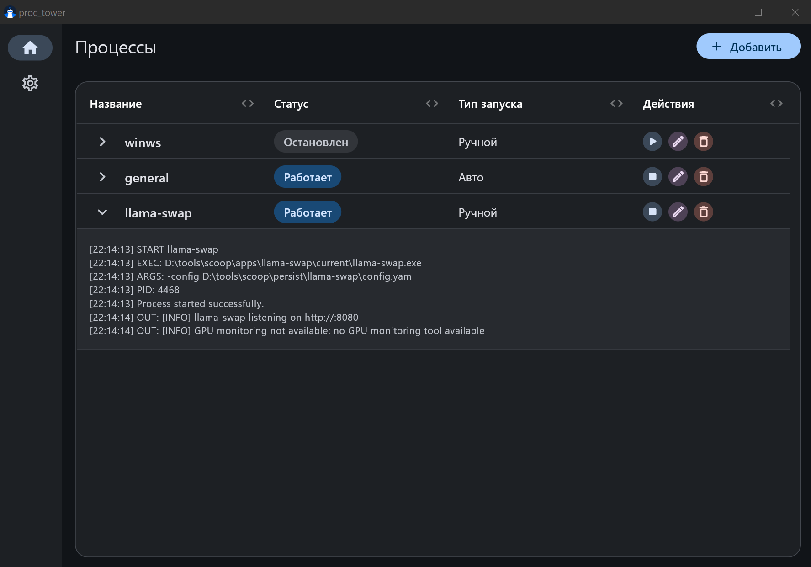
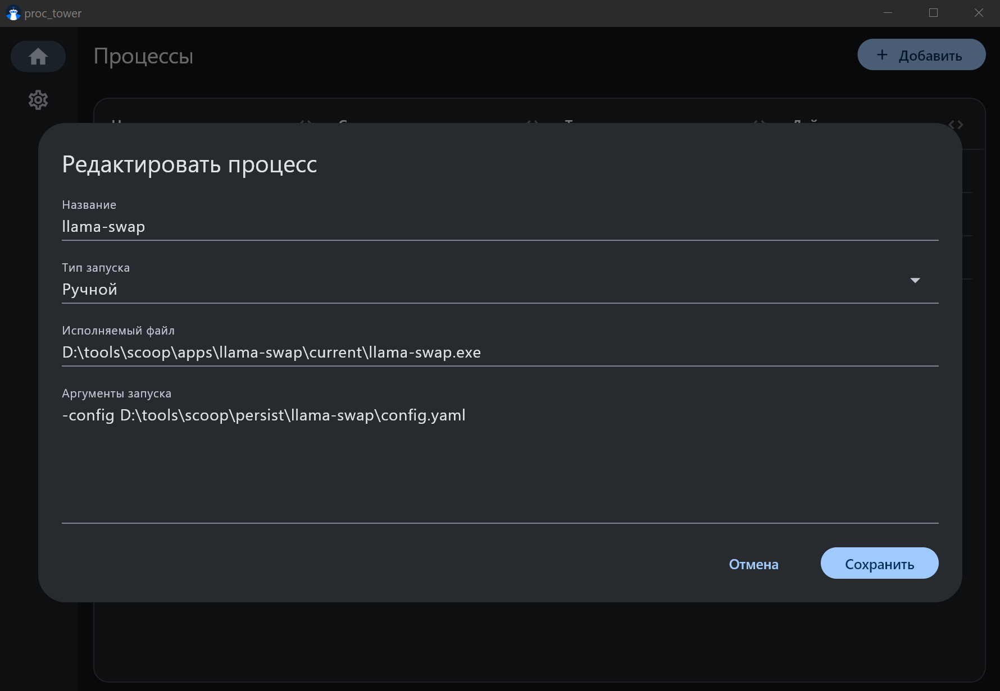

<p align="center">
  
</p>

# Proc Tower

Proc Tower is a desktop app for managing custom background processes on Windows, Linux, and macOS.

It lets you keep a list of commands, start and stop them from the UI, inspect their current status, and view process logs

## Data folder

The data folder contains `processes.json` and `settings.json`. Process logs are
kept in memory. Storage is selected at startup in this order:

1. Portable mode, enabled by an empty `portable.flag` beside the executable
   (beside the `.app` bundle on macOS).
2. The `PROC_TOWER_DATA_DIR` environment variable, containing an absolute path.
3. Standard storage in the user's system application folder.

Standard storage uses the system application support directory. On Windows,
this defaults to `%APPDATA%\Proc Tower`. Replacing the
application or extracting a new version to another folder preserves this profile.

Portable mode stores data in `app_data` beside the program. This mode does not
read the system profile or the environment override. Preserve
`portable.flag` and `app_data` when updating. Flutter's
own `data` folder contains runtime assets and should be replaced during updates.

The settings screen shows the current folder and path source. To use a custom
folder, set `PROC_TOWER_DATA_DIR` before launching the application.

For example, in PowerShell:

```powershell
$env:PROC_TOWER_DATA_DIR = 'D:\ProcTowerData'
.\proc_tower.exe
```

Or set `PROC_TOWER_DATA_DIR` in your user environment or a persistent launch
script. Setting `$env:PROC_TOWER_DATA_DIR` in a terminal only affects processes
launched from that session. The folder specified by `PROC_TOWER_DATA_DIR` must
already exist and be readable and writable. An invalid path produces a startup
error instead of silently opening an empty profile. Changing the path selects
the data to use at the next launch; data is never moved automatically.

## Screenshots

<div align="center">
   
</div>

## Run the project

### Install dependencies

```bash
flutter pub get
```

### Run

```bash
flutter run -d windows
```

```bash
flutter run -d linux
```

```bash
flutter run -d macos
```

### Build

```bash
flutter build windows
```

```bash
flutter build linux
```

```bash
flutter build macos
```
